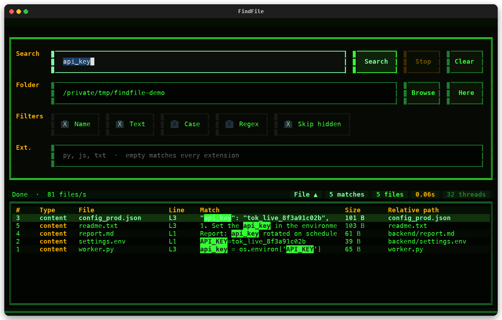

# FindFile

A fast terminal UI for searching files by **name** and **content**. Written in
Python 3 with Textual and Rich, and scanned with a thread pool.



## Features

- **Streaming parallel search**
  - Directory walk through `os.scandir`; content scanning spread across a
    thread pool sized from the CPU count.
  - Files are read in a single open, line by line, so memory stays bounded
    even for large files.
  - Best-effort fast path for ASCII literals and case-sensitive searches;
    non-ASCII case-insensitive terms and regular expressions use a decoded
    line scan.
  - Binary files (images, video, PDFs, executables, databases, and similar)
    and heavy caches (`.git`, `node_modules`, `.venv`, and similar) are
    skipped. Both behaviours are documented under [Limits](#limits).
- **Search modes**
  - **Name**: file names that contain the term, a shell wildcard (`*`, `?`,
    `[seq]`, matched against the whole name), or a regular expression.
  - **Text**: line number and snippet from inside the file.
  - **Both**: name hits and content hits in one run.
  - **Case**: optional case-sensitive matching, including accented UTF-8.
  - **Extensions**: limit the scan (`py, js, ts, txt`). Empty means every
    extension.
- **Interface**
  - Green-phosphor mainframe look: near-black screen, phosphor green text,
    and amber accents.
  - Live results with the term highlighted in file names and snippets
    (wildcard queries highlight the whole matching name).
  - Sort by clicking any column header; the status bar shows the current
    sort column and direction.
  - Live counters for matches, files, elapsed time, threads, and files per
    second.
  - Result cap (default 5,000) so the table cannot grow without bound.
  - Empty state before searching and explicit messages for no matches,
    cancelled searches, unreadable files, and the result cap.
- **Print mode** (`-p`)
  - Runs one search without the UI and prints grep-style lines
    (`path` for name hits, `path:line:snippet` for content hits), sorted.
  - Exit status 0 on a match and 1 on none, so it works in scripts and pipes.
- **Folder picker**
  - Shortcuts: Home, Here, Docs, Downloads, and Up.
  - Editable path (press Enter to accept) plus a directory tree.
- **Preview**
  - `Enter` or a double-click opens metadata and a syntax-highlighted window
    around the matching line. Only that window is read, so previewing a huge
    log stays fast and memory-light.
  - `o` opens the file in the default application.
  - `f` reveals it in Finder or the system file manager.
  - `c` copies the full path; `y` copies the matched line.

## Install

Python 3.9 or newer, on macOS or Linux.

From a clone:

```bash
git clone https://github.com/cassiomc1/findfile.git
cd findfile
pip install -r requirements.txt
```

Or install it as a command with pip/pipx:

```bash
pip install .
# or: pipx install .
```

Dependencies are `textual` and `rich`.

### macOS app

`build_app.sh` installs `FindFile.app` and a `findfile` command:

```bash
chmod +x build_app.sh
./build_app.sh
```

That places the app in `/Applications` (Finder, Launchpad, Spotlight, and the
Dock) and installs `~/.local/bin/findfile`.

```bash
./build_app.sh --user      # ~/Applications instead
./build_app.sh --no-cli    # skip the terminal command
./build_app.sh --target /path/to/FindFile.app
```

## Use

```bash
python3 findfile.py
# or, after installing:
findfile
```

Optional arguments open the UI already pointed at a folder, a term, or both:

```bash
python3 findfile.py ~/Documents
python3 findfile.py ~/Projects "database"
python3 findfile.py ~/Projects "def main" -c
python3 findfile.py ~/Projects "def\s+test_\w+" -c -r
python3 findfile.py ~/Projects "api_key" -c -e py,js
```

Add `-p` to print the results and exit instead of opening the UI:

```bash
findfile ~/Projects "TODO" --no-name -p | head
findfile . "*.md" -p
```

| Flag | Meaning |
| :--- | :--- |
| `folder` | Folder to search. Default: current directory. |
| `query` | Term to search as soon as the UI opens. |
| `-c`, `--content` | Also search inside files. |
| `--no-name` | Search contents only, not file names (implies `-c`). |
| `-p`, `--print` | Print matches and exit, without the UI (exit 1 when nothing matches). |
| `-r`, `--regex` | Treat the term as a regular expression. |
| `-s`, `--case-sensitive` | Match case exactly. |
| `-e`, `--ext LIST` | Extension filter, e.g. `py,js,txt`. |
| `-w`, `--workers N` | Content scan threads (default: CPU-based). |
| `--max-results N` | Stop after N matches (default: 5,000). |
| `--no-ignore` | Also search hidden folders and development caches. |
| `--version` | Print the version and exit. |

## Keyboard

| Key | Action |
| :--- | :--- |
| `Enter` in a field | Start the search |
| `Esc` | Stop a running search, or close a dialog |
| `Enter` or double-click on a row | Open the preview |
| Column header | Sort by that column; click again to reverse |
| `Ctrl+F` or `/` | Focus the search field |
| `Ctrl+P` | Open the folder picker |
| `Ctrl+L` | Clear results and counters |
| `Ctrl+K` | Open the command palette |
| `o` | Open the file in the default app |
| `f` | Reveal the file in Finder (or the system file manager) |
| `c` | Copy the absolute path |
| `y` | Copy the matched snippet (file name for name hits) |
| `F1` or `?` | Help |
| `q` | Quit |

## Limits

These defaults keep a search responsive and its memory bounded:

- Content search reads files up to **30 MB**; larger files still match by name.
- Binary files are skipped for content search, and at most **40 matches** are
  reported per file.
- The total result count is capped at **5,000** (configurable with
  `--max-results`).
- **Skip hidden** (on by default) ignores dot-directories and the caches in
  `IGNORED_DIRS`, such as `node_modules` and `.venv`. Turn it off to search
  everything.
- Symlinked files are followed; symlinked directories are not, so the walk
  cannot loop.
- Regular expressions and text matching are line-based. Patterns that need to
  span lines are not supported for content results.

## Development

```bash
python3 -m venv .venv
.venv/bin/pip install -e ".[dev]"

.venv/bin/python test_findfile.py   # plain runner, no pytest required
.venv/bin/pytest -q                 # same tests through pytest
.venv/bin/ruff check .
```

The suite covers name/content search, wildcards, regex, case sensitivity,
Unicode, extension filters, binary and cache skipping, cancellation and the
result cap, print mode, windowed previews, plus headless Textual tests for searching, sorting, clearing,
dialogs, and markup-safe rendering.

### Layout

| Path | Purpose |
| :--- | :--- |
| `findfile.py` | Engine, terminal UI, and CLI, kept in one self-contained file. |
| `test_findfile.py` | Engine, helper, CLI, and headless UI tests. |
| `build_app.sh` | Builds and installs the macOS `.app` and CLI wrapper. |
| `scripts/generate_icon.py` | Regenerates `assets/AppIcon.icns` (needs Pillow). |
| `pyproject.toml` | Packaging, pytest, and ruff configuration. |
