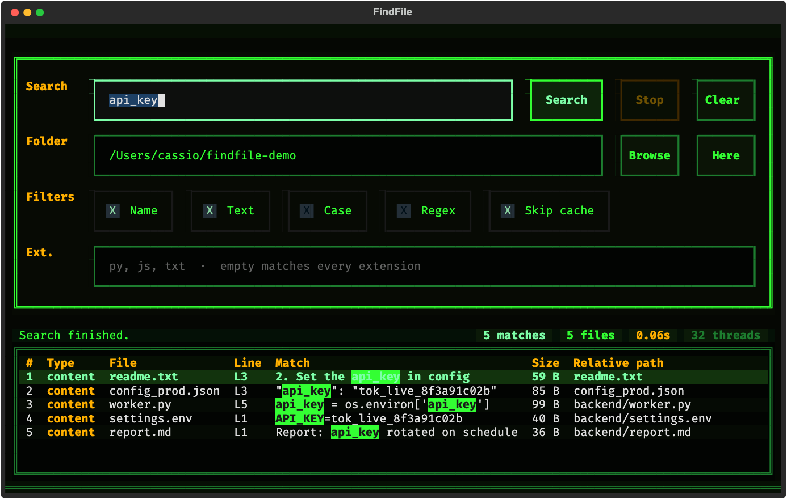

# FindFile

A fast terminal UI for searching files by **name** and **content**. Written in Python 3 with Textual and Rich, and scanned with a thread pool.

## Screenshot



## Features

- **Parallel search**
  - Directory walk through `os.scandir`.
  - Worker count scales with the CPU.
  - One open per file: size, binary check, and content scan share a single descriptor. ASCII literals are matched on bytes; accented text and regular expressions use Unicode.
  - Skips binaries (images, video, PDFs, executables, SQLite, and similar) and heavy caches (`.git`, `node_modules`, `.venv`, and similar).
- **Interface**
  - Green-phosphor mainframe look: near-black screen, phosphor green text, and amber accents.
  - Search, folder, filters, and a results table.
  - Live highlight of the term or regular expression in file names and snippets.
  - Sort by clicking a column header (`#`, `Type`, `File`, `Line`, `Match`, `Size`, `Relative path`).
  - Results stream in batches, with a cap so the table cannot grow without limit.
  - Live counts for matches, files scanned, elapsed time, threads, and files per second.
  - Empty state before a search, and a clear message when nothing matches.
- **Folder picker**
  - Shortcuts: Home, Here, Docs, Downloads, and Up.
  - Editable path, plus a directory tree.
- **Search modes**
  - **Name**: file names that contain the term (`*`, `?`, or a regular expression).
  - **Text**: line number and snippet from inside the file.
  - **Both**: name hits and content hits in one run.
  - **Case**: optional case-sensitive matching, including accented UTF-8.
  - **Extensions**: limit the scan (`py, js, ts, txt`). Leave it empty to search every extension.
- **Preview**
  - `Enter` on a row opens metadata and a syntax-highlighted preview, with the matching line marked.
  - `o` opens the file in the default application.
  - `f` reveals it in Finder or the system file manager.
  - `c` copies the full path.
  - `y` copies the matched line (preview only).

## Install

Python 3.9 or newer (tested through 3.14), on macOS or Linux.

```bash
git clone https://github.com/cassiomc1/findfile.git
cd findfile
pip install -r requirements.txt
```

Dependencies are `textual` and `rich`.

### macOS app

`build_app.sh` installs `FindFile.app` and a `findfile` command:

```bash
chmod +x build_app.sh
./build_app.sh
```

That places the app in `/Applications` (Finder, Launchpad, Spotlight, and the Dock) and installs `~/.local/bin/findfile`.

```bash
./build_app.sh --user      # ~/Applications instead
./build_app.sh --no-cli    # skip the terminal command
./build_app.sh --target /path/to/FindFile.app
```

## Use

```bash
python3 findfile.py
```

Or:

```bash
chmod +x findfile.py
./findfile.py
```

Optional arguments open the UI already pointed at a folder, a term, or both:

```bash
python3 findfile.py ~/Documents
python3 findfile.py ~/Projects "database"
python3 findfile.py ~/Projects "def main" -c
python3 findfile.py ~/Projects "def\s+test_\w+" -c -r
```

| Flag | Meaning |
| :--- | :--- |
| `folder` | Folder to search. Default: current directory. |
| `query` | Term to search as soon as the UI opens. |
| `-c`, `--content` | Also search inside files. |
| `-r`, `--regex` | Treat the term as a regular expression. |

## Keyboard

| Key | Action |
| :--- | :--- |
| `Enter` in a field | Start the search |
| `Esc` | Stop a running search, or close a dialog |
| `Enter` or double-click on a row | Open the preview |
| Column header | Sort by that column |
| `Ctrl+F` or `/` | Focus the search field |
| `Ctrl+P` | Open the folder picker |
| `Ctrl+K` | Open the command palette |
| `Ctrl+L` | Clear results and counters |
| `o` | Open the file in the default app |
| `f` | Reveal the file in Finder |
| `c` | Copy the absolute path |
| `y` | Copy the matched snippet (preview) |
| `F1` or `?` | Help |
| `q` | Quit |

## Tests

```bash
python3 test_findfile.py
```

The suite covers name search, multithreaded content search, UTF-8 accents, regular expressions, case sensitivity, extension filters, the result cap, and cancellation.
